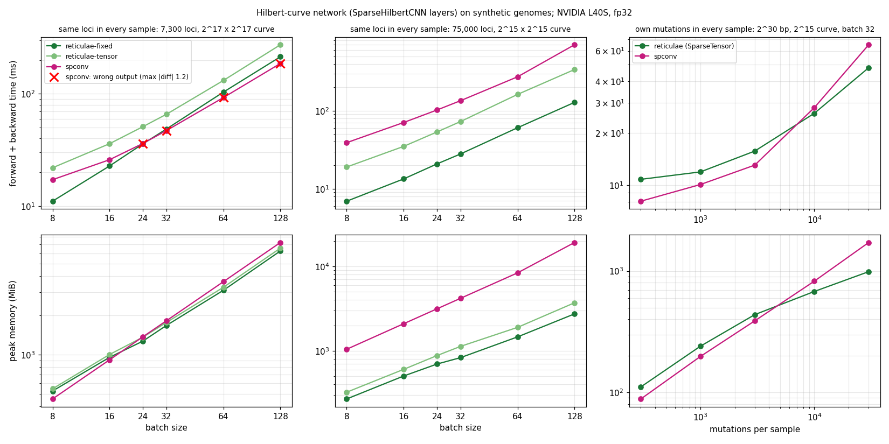
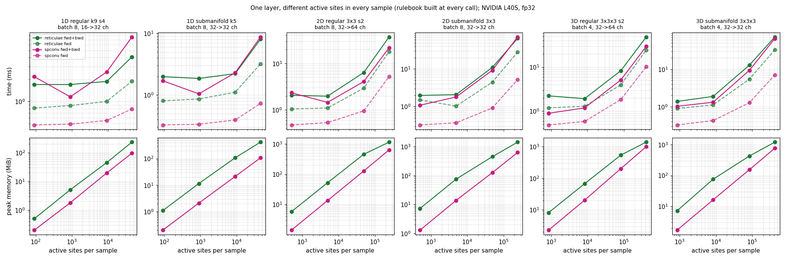

# reticulae

Sparse convolutional networks in **pure PyTorch**: no CUDA extension, no compilation, no dependency besides `torch` and
`numpy`. It runs wherever PyTorch runs (CPU or GPU), with autograd and `torch.autocast`, on grids of any size up to
batch × volume < 2^62.

What it implements, in 1D, 2D and 3D (or any D):
- regular, submanifold, transposed and inverse sparse convolutions, all with stride, padding and dilation;
- max, average and global pooling;
- layers specialised for batches whose samples share the same active sites (fastest for genotyping panels);
- compact storage of sparse images: coordinates in the smallest unsigned type, values bit-packed (e.g. 2 bits per
  dosage);
- genome images on a Hilbert curve, with the HC network of SchizophreniaGI.

Every operation equals the corresponding dense PyTorch operation on the zero-filled image
([Correctness](#correctness)), and matched [spconv](https://github.com/traveller59/spconv) to 3e-6, which was used as
an extra reference.

**Documentation:**
- this page: the ideas and the main usage;
- [docs/API.md](docs/API.md): the complete reference (every class and function, its shapes, formula and an example);
- [examples/quickstart.py](examples/quickstart.py): every feature in a few lines each, ready to run.

## Contents

- [Install](#install)
- [Two kinds of active sites](#two-kinds-of-active-sites)
- [Quick start](#quick-start)
- [Compact storage of genomic data: SparseImages](#compact-storage-of-genomic-data-sparseimages)
- [How it works without a special library](#how-it-works-without-a-special-library)
- [Reproducibility on the GPU](#reproducibility-on-the-gpu)
- [Correctness](#correctness)
- [Benchmarks against spconv](#benchmarks-against-spconv)
- [Differences from spconv](#differences-from-spconv)
- [Examples](#examples)
- [License](#license)

## Install

```bash
git clone git@github.com:AI-for-Genome-Interpretation-lab/reticulae.git
cd reticulae && pip install -e .        # or add the folder to PYTHONPATH
```

## Two kinds of active sites

A sparse image stores only its **active sites** (pixels or voxels); every other site is absent. reticulae handles two
kinds of batches, and choosing the right one matters for both meaning and speed.

**Own sites per sample.** Each sample has its own set of active pixels. Example: genomes stored as mutation lists, where
each genome keeps only the bases where it carries a mutation. Two genomes on a 4 × 4 image:

```
genome A (mutations at 3 bases)    genome B (mutations at 2 other bases)
. . 1 .                            . . . .
. . . .                            2 . . .
. 2 . .                            . . . 1
. . . 1                            . . . .
```

The reference bases (`.`) are not stored: they cost nothing, and a convolution produces nothing around them. The batch
is a `SparseTensor`: one row per active site, `indices [n, 1 + D]` = (sample, x_1, …, x_D) and `features [n, C]`.
Point clouds are the other typical case.

**Same sites in every sample.** Every sample has a value at the same pixels. Example: a genotyping panel, where every
genome has a dosage at the same 3 loci (0 = reference, 1, 2):

```
genome A                           genome B
. . 0 .                            . . 2 .
. . . .                            . . . .
. 1 . .                            . 0 . .
. . . 2                            . . . 1
```

Here a 0 **is** stored: it is an active site whose value is 0, so the outputs around it are active (they get the bias)
and the network can learn from "reference at this locus". The batch is a plain tensor `[sites, batch, C]`, and each
`Fixed*` layer receives the site coordinates once, when it is created.

| | own sites per sample | same sites in every sample |
|---|---|---|
| data | `SparseTensor` | tensor `[sites, batch, C]` + coordinates `[sites, D]` given to each layer |
| layers | `SparseConv`, `SubMConv`, `SparseConvTranspose`, `SparseInverseConv`, `SparseMaxPool`, `SparseAvgPool`, `globalPool` (+ `1d/2d/3d` aliases) | `FixedSparseConv`, `FixedSubMConv`, `FixedSparseConvTranspose`, `FixedSparseInverseConv`, `FixedSparsePool` |
| rulebook (which input feeds which output) | rebuilt for every batch, on the GPU | built once when the layer is created |
| speed | from 1.3× slower to 1.4× faster than spconv on genome networks | the fastest mode: up to 5.6× faster than spconv |
| use it when | the active pixels differ between samples | every sample is measured at the same positions |

The two give the same result when every sample has the same active sites (tested). With mutation lists and few
mutations per sample, use the first. With a panel of loci genotyped in everyone, use the second, even though most
values are 0.

## Quick start

```python
import torch as t
import reticulae as R

# own sites per sample: 2 samples on an 8 x 8 grid, 1 channel
x = R.SparseTensor(features = t.randn(5, 1), indices = t.tensor([[0, 1, 1], [0, 5, 2], [1, 3, 3], [1, 3, 4], [1, 7, 7]]),
	spatialShape = (8, 8), batchSize = 2)
h = R.SubMConv2d(1, 16, 3)(x)                          # submanifold: same active sites
h = h.replace(t.relu(h.features))                      # any per-site operation
h = R.SparseConv2d(16, 32, 3, s = 2, p = 1)(h)         # regular, stride 2 (also d = dilation)
h = R.SparseMaxPool2d(2)(h)                            # max over the active sites of each window
v = R.globalPool(h, "mean")                            # [2, 32], one vector per sample
img = h.dense()                                        # [2, 32, 2, 2], zeros where inactive
```

```python
import numpy as np

# same sites in every sample: the coordinates are given once, the batch is a dense dimension
coords = np.array([[0, 0], [0, 1], [5, 5], [6, 5], [7, 7]])
c1 = R.FixedSparseConv(coords, (8, 8), cin = 1, cout = 4, k = 2, s = 2)
c2 = R.FixedSubMConv(c1.outCoords, c1.outShape, 4, 4, k = 3)
y = c2(c1(t.randn(5, 32, 1)))                          # [sites, batch, channels] -> [c1.nOut, 32, 4]
```

Sparse U-Net step: `SparseConv(..., key = "down1")` downsamples, and `SparseInverseConv(..., key = "down1")` brings the
features back to exactly its input sites. `SparseConvTranspose` is the sparse `ConvTranspose`. All formulas and
output shapes are in [docs/API.md](docs/API.md#3-convolutions-own-sites-per-sample).

## Compact storage of genomic data: SparseImages

A dataset of genome images is mostly empty. Stored densely, one 2^16 × 2^16 image of a 3.1e9 bp genome takes 4.3 GB,
even in `uint8`. `SparseImages` keeps only the active sites of every sample, in CPU memory or in an `.npz` file, and
hands out `SparseTensor` batches for training:

| what | how it is stored |
|---|---|
| coordinates | one array per dimension, in the smallest unsigned type that holds the grid size: `uint8` up to 256, `uint16` up to 65,536 (a whole 3.1e9 bp genome on a 2^16 × 2^16 Hilbert curve), `uint32` up to 2^32 |
| values | a `PackedArray`: integers in [0, 2), [0, 4) or [0, 16) bit-packed with 1, 2 or 4 bits (genotypes 1/2: 2 bits); other integers in the smallest integer type; floats as given; **0 bytes** if every value is the same (e.g. presence of a mutation, `values=None`) |
| samples | an offsets array (sample i = rows `offsets[i]:offsets[i+1]`), not a sample column on every site |
| absent sites | nothing: a reference base costs nothing |

Measured with `examples/storageGenomes.py`: 1,000 simulated genomes of 3.1e9 bp with ~3,000 mutations each (3.0 million
in total), and a panel of 1,000 samples × 100,000 loci:

| data | representation | size | per entry |
|---|---|---|---|
| mutation lists | dense `uint8` images | 4.3 TB | 1.4 MB per mutation |
| mutation lists | `SparseTensor` (int64 indices + float32 values) | 84 MB | 28 bytes |
| mutation lists | int64 genome position + int8 genotype | 27 MB | 9 bytes |
| mutation lists | **`SparseImages`** (2 × `uint16` + 2-bit genotype + offsets) | **12.8 MB** | **4.25 bytes** |
| mutation lists | **`SparseImages`**, presence only (`values=None`) | 12.0 MB | 4.0 bytes |
| panel | `int8` matrix | 100 MB | 1 byte |
| panel | **`PackedArray`** (0/1/2, 3 = missing) | **25 MB** | **2 bits** |

The `.npz` file has the same size as the memory figure.

From per-sample mutation lists to network batches:

```python
import numpy as np
import reticulae as R

layout = {"chr1": 2_000_000, "chr2": 1_500_000}                 # the genome: chromosome order and lengths
genomes = [(["chr1", "chr2"], [10_500, 700_000], [1, 2]),          # per sample: chromosomes, positions, genotypes
	(["chr2"], [42], [1])]
coords, values = [], []
for chrom, pos, genotype in genomes:
	xy, order = R.hilbertXY(chrom, pos, layout)                    # same layout -> same pixel for the same base
	coords.append(xy); values.append(np.array(genotype))
images = R.SparseImages.fromLists(coords, values, (1 << order, 1 << order))
images.save("genomes.npz")
x = R.SparseImages.load("genomes.npz").batch([0, 1])            # SparseTensor for SparseConv2d / SubMConv2d ...
```

Pass the same `chromLengths` layout for every sample: it fixes the chromosome order and the curve size, so a base maps
to the same pixel in every genome. For a genotyping panel, the `[samples, loci]` dosage matrix itself is the data
(same sites in every sample): `R.PackedArray(np.where(X == -127, 3, X))` stores it with 2 bits per genotype, and
`packed[rows]` decodes a batch.

## How it works without a special library

A sparse convolution is not a special operation. It is the dense convolution of the zero-filled image, evaluated only
where the result can be non-zero. Computing it takes two steps:

1. **The rulebook**: the (input site, output site, kernel offset) triples whose input is active. For a regular
   convolution, input x reaches output o = (x + p − d·δ)/s through offset δ when that is an integer inside the grid.
2. **Gather → matmul → scatter-add**: for every offset δ, the input rows of its pairs are multiplied by the matrix W[δ]
   and added to their output rows.

Both steps are standard tensor operations (`unique`, `searchsorted`, indexing, `bmm`, `index_add_`), and autograd
differentiates them. What spconv (or MinkowskiEngine and TorchSparse) adds is **speed**: hand-written CUDA kernels
that build rulebooks with GPU hash tables, and fused kernels that never materialise the gathered rows. A naive PyTorch
version is slow. A Python loop over the K offsets launches 3K small kernels per layer forward and 5K backward, and
building the rulebook per offset costs as much again. That is why a special library used to be needed.

reticulae avoids these costs within PyTorch:

- **Shared sites → rulebook built once.** When every sample has the same active sites, the rulebook does not depend
  on the batch. It is computed once, and the batch becomes a dense dimension of every matmul. Features are site-major,
  `[sites, batch, C]`, so gathering a site copies one contiguous row.
- **One gather, one `bmm`, one scatter per layer, whatever the kernel size.** The pairs are grouped by offset and each
  group is padded to the largest, giving `[R, M]` index tables (2–21% padding on genotyping panels). By default the
  scatter is issued one offset at a time, so that results are reproducible
  ([Reproducibility on the GPU](#reproducibility-on-the-gpu)).
- **Submanifold centre offset as a plain matmul.** Every site maps to itself through the centre offset, so its group
  is much larger than the others; computed apart, it no longer dominates the padding (4× waste in 3D otherwise).
- **Rulebooks by sorting instead of hash tables.**
  - Submanifold: sites are keyed on the grid padded by d·(k−1)/2, so a neighbour's key is the site's key plus a
    constant per offset. Lookup is one broadcast add and one `searchsorted`, with no bounds checks.
  - Regular and transposed: validity and output coordinates separate by dimension, so they are built per dimension
    and combined by broadcasting.
- **Lean backward.** A custom `autograd.Function` recomputes the gather instead of storing it. The weight gradient (R
  long reductions into tiny cin × cout outputs, which would leave the GPU idle) is split into chunks. When the gathered
  rows exceed a memory budget, the offsets are processed in chunks.

## Reproducibility on the GPU

> [!IMPORTANT]
> **By default (`reticulae.Convolutions.DETERMINISTIC = True`) every layer gives bitwise-identical results when it is
> run twice on the same input with the same weights, on the GPU as on the CPU, so that a training run with a fixed
> seed can be repeated exactly.** Set `reticulae.Convolutions.DETERMINISTIC = False` for at most a few percent more
> speed on large layers, at the price of results that change slightly from run to run.
>
> **The issue.** The last step of a sparse convolution adds the products of every kernel offset into the output sites
> (scatter-add, `index_add_`). Floating-point addition is not associative: (a + b) + c can differ from a + (b + c) in
> the last bit. On the GPU, `index_add_` adds with atomic operations, and when several inputs reach the same output
> site, the order of their additions depends on the scheduling of the GPU threads, which changes from run to run.
> If all the offsets are scattered in a single call, every output site with more than one active input in its
> receptive field is such a collision. The differences are of the order of 1e-7, but training amplifies them: two
> runs of the same network, seed and data end at different weights. On a genotyping panel (7,314 loci, the 9 layers of
> `SparseHilbertCNN`, early stopping and 4 hyperparameter configurations), two runs gave test correlations of 0.236 and 0.242, and their inner-validation
> scores, which decide early stopping and the hyperparameters, differed by up to 0.04.
>
> **The fix.** Within one kernel offset, an output site receives at most one input (for a fixed offset δ, the map
> input → output is one-to-one). With `DETERMINISTIC = True` the scatter-add is issued one offset (one row of the
> rulebook table) at a time: no two atomic additions of a call hit the same site, and the offsets are added in a fixed
> order. Pooling, `globalPool` and the input of `SparseHilbertCNN`, whose collisions are not organised by offset, use
> `index_put_(accumulate = True)`, which sorts the indices before adding. No global PyTorch setting is needed
> (`torch.use_deterministic_algorithms(True)` has the same effect, but it is global and was 1.4× slower on the
> genotyping panel).
>
> **The cost** is one kernel launch per offset instead of one per chunk. Measured on an NVIDIA L40S
> (`benchmarks/benchDeterminism.py`, `benchmarks/results/determinism.tsv`, the 24 layers of the benchmark below):
> 1.00–1.14× the time of the atomic version from 10^5 active sites per sample, up to 1.6× on tiny layers of 2–3 ms
> (at most +1.4 ms). The atomic version gave bitwise-repeatable gradients in only 11 of the 24 layers, the
> deterministic one in all 24. The Hilbert network on the genotyping panel above takes 37.8 ms per forward + backward
> pass (batch 32), against 37.2 ms with atomics. The spconv comparison below was measured with atomics.

## Correctness

```bash
python -m pytest -q tests                  # CPU
DEVICE=cuda:0 python -m pytest -q tests    # GPU (+ the spconv cross-checks if spconv is installed)
```

253 tests. On CPU, 240 pass and 13 GPU-only tests are skipped. On an NVIDIA L40S, 241 pass; the 12 spconv cross-checks
are skipped when spconv is not installed (they passed with spconv-cu126 2.3.8). Each operation is compared with an
independent reference:

| operation | reference |
|---|---|
| regular convolution (26 kernel / stride / padding / dilation settings, incl. anisotropic and k < s; 2–3 densities; 1D/2D/3D) | `conv1d/2d/3d` of the zero-filled image, float64, 1e-10; the active output sites must be exactly those whose receptive field contains an active input |
| submanifold convolution (15 kernels and dilations) | dense convolution with padding d·(k−1)/2, at the input sites |
| transposed convolution (9 settings × 2 densities) | `conv_transpose1d/2d/3d`; the active output sites must be exactly those receiving from an active input |
| inverse convolution (8 settings, after a submanifold layer) | unpadded `conv_transposeNd` of the downsampled image, read on the input grid; an input with other sites is rejected |
| max / average pooling (9 settings × 2 densities) | `max_poolNd` with inactive sites at −∞; window sum / number of active sites |
| global pooling | dense max / mean / sum |
| huge grids (1D 2^40, 2D 2^30 × 2^30, 3D 2^20 × 2^20 × 2^20) | a brute-force Python loop over the active sites |
| gradients | `gradcheck`, `gradgradcheck`; input, weight and bias gradients of every operation against the dense one; chunked paths |
| fixed-sites layers | the per-sample layers with every sample having the same sites |
| Hilbert network | a dense masked re-implementation, and a per-offset loop implementation (predictions and every gradient equal to 1e-9) |
| determinism | every layer (fixed sites and per-sample, convolutions, pooling, `globalPool`, the Hilbert network with loci sharing a pixel) run twice on a fully active grid: bitwise-identical outputs and gradients (this test fails on the GPU with `DETERMINISTIC = False`) |
| storage | exact round trips of `PackedArray` (1/2/4 bits, signed/unsigned, floats, constants) and `SparseImages` (batches, save/load); smallest dtypes; byte counts |
| spconv (if installed) | `SparseConvNd`, `SubMConvNd` (incl. dilation), `SparseConvTransposeNd`, `SparseInverseConvNd`, `SparseMaxPoolNd`: same sites, values within 1e-4 (observed ≤ 3e-6) |

We also mutation-tested the suite: 13 bugs injected on purpose into the rulebooks and the kernel (transposed kernel,
missing stride or border check, ignored padding, flipped submanifold kernel, padding rows reading or writing real
sites, wrong chunk reduction, centre offset dropped, wrong cache key, …) are each caught.

## Benchmarks against spconv

NVIDIA L40S, PyTorch 2.11, spconv-cu126 2.3.8, float32, median of 10–20 repetitions after warm-up, measured with
`DETERMINISTIC = False` (see [Reproducibility on the GPU](#reproducibility-on-the-gpu) for the cost of the default). All data are
synthetic. The outputs of the two libraries are compared in every configuration (column `max_abs_diff` of
`benchmarks/results/*.tsv`). To reproduce (spconv needed):

```bash
python benchmarks/benchHilbert.py cuda:0 benchmarks/results/panels.tsv benchmarks/results/mutations.tsv
python benchmarks/benchLayers.py cuda:0 benchmarks/results/layers.tsv
python benchmarks/plot.py
```

**Genome images**, forward + backward of the Hilbert-curve network (SparseHilbertCNN layers):



| batch 32 | reticulae | spconv |
|---|---|---|
| same 75,000 loci in every sample (2^15 curve) | **28 ms, 831 MiB** (fixed sites) | 135 ms, 4,191 MiB |
| same 7,300 loci in every sample (2^17 curve) | 49 ms, **1,674 MiB** (fixed sites) | 47 ms, 1,818 MiB, **wrong output** |
| own 300 mutations per sample (2^30 bp, 2^15 curve) | 10.8 ms, 111 MiB | **8.1 ms, 88 MiB** |
| own 30,000 mutations per sample | **48 ms, 989 MiB** | 65 ms, 1,720 MiB |

- **Same sites in every sample:** reticulae's fixed-sites layers are 4.5–5.6× faster than spconv on the 75,000-locus
  panel (3.9–7× less memory). On the 7,300-locus panel they are 1.6× faster at batch 8, equal at batch 24–32 and up
  to 15% slower at 64–128, with up to 14% less memory from batch 24.
- **spconv bug:** on the 2^17 × 2^17 grid its output is wrong (errors around 1) from batch 24, while it is correct at
  batch 16 (red crosses).
- **Own mutations per sample:** reticulae (`SparseTensor`) is 1.2–1.3× slower than spconv up to 3,000 mutations per
  sample, and faster, with less memory, from 10,000.

**Single layers, own sites per sample** (spconv's home ground), against the number of active sites per sample, with
the rulebook built at every call:



- spconv's fused kernels win the **forward pass** (reticulae 1.7–5.4× slower).
- **Forward + backward** ranges from 1.9× faster to 2.5× slower (at most 1.7× from 10^5 sites per sample).
- reticulae uses 1.4–5.6× more **memory**, because it materialises the gathered rows.

## Differences from spconv

- **Same sites and values** for regular, submanifold, transposed and inverse convolutions (with dilation).
- **Max pooling.** reticulae returns the maximum over the active inputs (= dense max pooling with −∞ at inactive
  sites); spconv returns max(0, that). They agree after a ReLU.
- **Weight layout.** `[prod(k), cin, cout]` (spconv: `[cout, *k, cin]`; conversion in [docs/API.md](docs/API.md#1-concepts)).
  Indices are int64.
- **Inverse convolutions** need no `indice_key` bookkeeping beyond the `key` of the downsampling convolution, and
  check that their input has the right sites.
- **Extra features:** fixed-sites layers, compact storage, average and global pooling, any grid size (spconv returned
  wrong values on a 2^17 × 2^17 grid at batch ≥ 24).
- **Not implemented:** grouped convolutions (see [docs/API.md](docs/API.md#9-not-implemented)).
- **Determinism:** `index_add_` uses atomic additions on the GPU, so results vary between runs by about 1e-7 in
  float32.

## Examples

Each prints and saves the train and test performance (`examples/results/*.perf.tsv`) and every prediction with its
label and sample id (`*.preds.tsv`). All data are simulated.

| script | what it shows | result (test) |
|---|---|---|
| `quickstart.py` | every feature in a few lines (CPU, seconds) | — |
| `storageGenomes.py` | `SparseImages` for 1,000 genomes × 3,000 mutations, and `PackedArray` for a genotyping panel: the size table above | — |
| `genomeHilbert.py cuda:0` | same loci in every sample: `SparseHilbertCNN` on 7,300 loci (2^17 × 2^17 curve), two traits | r = 0.39 / 0.36 |
| `mutationsHilbert.py cuda:0` | own mutations per sample: 6,000 genomes × 300 mutations with dosage, kept in `SparseImages` (7.7 MB, 4.3 bytes per mutation), `SparseConv2d` network, rare-variant burden | r = 0.46 |
| `pointCloud3d.py cuda:0` | 3D point clouds: `SubMConv3d` + `SparseConv3d` + global max, sphere / cube / torus | accuracy 0.95 |

## License

GNU General Public License v3.0 or later ([LICENSE](LICENSE)).
